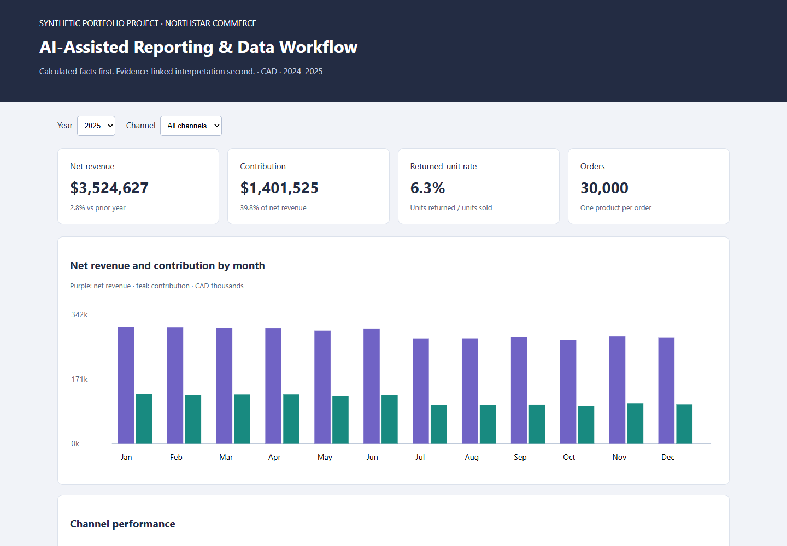

# AI-Assisted Reporting & Data Workflow

A runnable personal portfolio project combining Python validation, SQLite analysis, an offline dashboard and evidence-linked AI reporting. It uses 60,000 synthetic e-commerce orders covering 2024–2025 across four channels and three product categories, plus six deliberately injected source defects.




[Recorded walkthrough](docs/recordings/walkthrough.mp4) · [Screenshot gallery](docs/screenshots) · [Capture details](docs/recordings/capture_manifest.json)

## Start here

- Open `reports/dashboard.html` for the filterable report.
- Read `reports/ai_management_report.md` for the assistant-authored findings with verified numerical evidence.
- Read `docs/project_walkthrough.md` for a first-person explanation of the implementation.

No real company records, production deployment or measured business savings are claimed. No external AI API or Excel/Power BI dependency is required.

## Reproduce the project

Python 3.10+ and its standard library are sufficient. From this folder:

```powershell
python src/generate_data.py
python src/pipeline.py
python src/verify_summary.py
python -m unittest discover -s tests -v
```

The generator overwrites the synthetic raw CSV deterministically. For routine analysis, run the pipeline against an existing extract using `--raw path/to/orders.csv --output path/to/reports`. The verifier accepts `--evidence`, `--summary` and `--output` paths. `automation/run_local.ps1` runs the pipeline and then the summary verifier; it stops if either fails.

The supplied summary is tied to the exact source and pipeline/SQL fingerprint. Changing data or analysis code requires a new AI summary using `ai/SUMMARY_PROMPT.md`; verifying a stale summary intentionally fails. The dashboard and SQL facts remain available while a new summary is pending.

## Business questions

1. Does revenue growth translate into contribution growth?
2. Which channel shows discounting or returns pressure?
3. Which data-quality issues should be resolved before reporting?
4. Can AI explain the evidence without inventing numerical results?

## Deliverables

| Folder | Contents |
|---|---|
| data/raw | Deterministic order export with intentional defects |
| src | Generator, validation/SQL pipeline, summary verifier and dashboard template |
| sql | Order economics, monthly/channel trends, category results and annual comparisons |
| reports | Clean CSV, SQLite database, dashboard, evidence packet, AI report and validation logs |
| ai | Reusable prompt, structured assistant summary and verification workflow |
| automation | Local PowerShell runner; no scheduled task installed |
| docs | Dictionary, business methodology and project walkthrough |
| tests | Regression tests for financial calculations and AI claim validation |

## What AI actually did

The assistant selected evidence and wrote interpretations and recommendations in `ai/summary.json`. SQL owns the calculations. The verifier compares each cited value, unit and dataset ID to the evidence packet, and the report renderer inserts the numbers. Qualitative statements still need human review. The local scripts do not call a model or regenerate prose automatically.

## Model assumptions

Each row is one order with one product; there is no multi-line order model. Net revenue subtracts discounts and refunds. Contribution subtracts all original product costs and shipping, including returned units assumed unsellable; it excludes advertising, fixed overhead and tax. Return units are attributed retrospectively to the original order month. These outputs are cohort analyses, not historical cash receipts or accounting close balances.

The source exports have no customer identifiers, ad spend, inventory or campaign experiments. Therefore this project does not calculate customer acquisition cost, lifetime value, return on ad spend, causal lift or stock turnover. The second-half Paid Search pattern is deliberately seeded.

## Operational limits

Run serially. The pipeline validates and reconciles before writing its generated outputs, but it is not a transactional production publisher. Outputs are replaced on rerun; preserve an external copy if historical report retention is required. Source-code fingerprints intentionally invalidate previous AI evidence. No reports are sent, scheduled or published externally.
